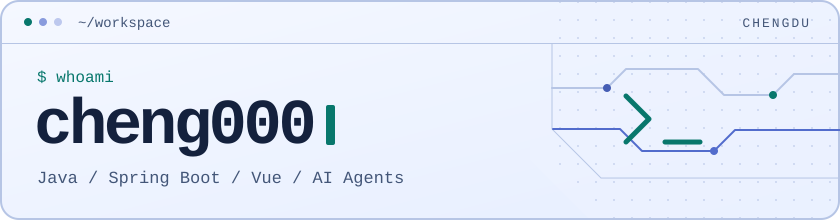
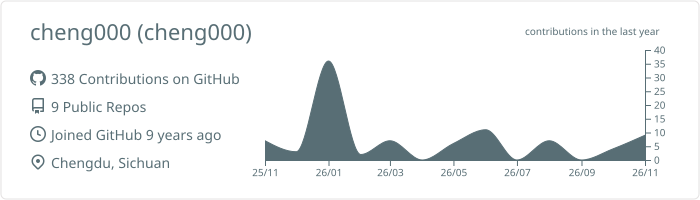
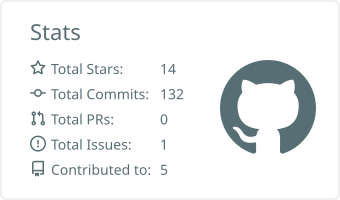
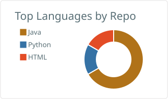
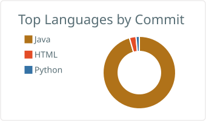

<picture>
  <source media="(prefers-color-scheme: dark)" srcset="assets/workspace-dark.svg">
  
</picture>

在成都写 Java 后端，也用 Vue 做前端。最近在探索 **AI Agent 工作流**和**自托管工具**，顺手把有用的开源项目整理成星标清单。

[星标导航](#星标导航) · [公开项目](#公开项目) · [全部星标 ↗](https://github.com/cheng000?tab=stars)

## 星标导航

| 方向 | 从这里开始 |
| :--- | :--- |
| **AI 与 Agent** | [Agent 工具](https://github.com/stars/cheng000/lists/02-ai-03-agenttools) · [AI 产品](https://github.com/stars/cheng000/lists/02-ai-02-ai-product) |
| **Java 后端** | [Spring Boot](https://github.com/stars/cheng000/lists/02-framelearn-01-springboot) · [Java](https://github.com/stars/cheng000/lists/01-language-01-java) |
| **前端与全栈** | [Vue](https://github.com/stars/cheng000/lists/02-framelearn-02-vue) · [前后端分离](https://github.com/stars/cheng000/lists/02-framelearn-03-frontendbackend) |
| **开发工具** | [常用工具](https://github.com/stars/cheng000/lists/05-tool) · [编辑器与浏览器插件](https://github.com/stars/cheng000/lists/04-plugin-idea-vscode-chrome) |

展开完整星标目录

- **语言与基础** · [算法](https://github.com/stars/cheng000/lists/01-algorithm) · [Java](https://github.com/stars/cheng000/lists/01-language-01-java) · [Python](https://github.com/stars/cheng000/lists/01-language-02-python) · [Shell](https://github.com/stars/cheng000/lists/01-language-03-shell-etc) · [HTML / CSS / JS](https://github.com/stars/cheng000/lists/01-language-04-htmlcssjs) · [移动开发](https://github.com/stars/cheng000/lists/01-language-05-mobile) · [学习路线](https://github.com/stars/cheng000/lists/01-programmer-01-learnmap)
- **AI 与 Agent** · [AI 基础](https://github.com/stars/cheng000/lists/02-ai-01-ai-basic) · [AI 产品](https://github.com/stars/cheng000/lists/02-ai-02-ai-product) · [Agent 工具](https://github.com/stars/cheng000/lists/02-ai-03-agenttools)
- **框架学习** · [Spring Boot](https://github.com/stars/cheng000/lists/02-framelearn-01-springboot) · [Vue](https://github.com/stars/cheng000/lists/02-framelearn-02-vue) · [前后端分离](https://github.com/stars/cheng000/lists/02-framelearn-03-frontendbackend) · [其他 Web 框架](https://github.com/stars/cheng000/lists/02-framelearn-04-otherwebframe) · [管理系统](https://github.com/stars/cheng000/lists/02-systemlearn-01-managesystem)
- **项目收藏** · [Spring Boot 项目](https://github.com/stars/cheng000/lists/03-myproject-01-springboot) · [Python 等项目](https://github.com/stars/cheng000/lists/03-myproject-02-python-etc) · [Web 项目](https://github.com/stars/cheng000/lists/03-myproject-03-web) · [移动项目](https://github.com/stars/cheng000/lists/03-myproject-04-mobile)
- **项目模板** · [Spring Boot](https://github.com/stars/cheng000/lists/03-template-01-springboot) · [Spring Boot 多模块](https://github.com/stars/cheng000/lists/03-template-02-springbootmulti) · [Vue / React](https://github.com/stars/cheng000/lists/03-template-03-vue-react) · [Bootstrap](https://github.com/stars/cheng000/lists/03-template-04-bootstrap) · [移动端](https://github.com/stars/cheng000/lists/03-template-05-mobile)
- **库与插件** · [Web 库](https://github.com/stars/cheng000/lists/04-library-01-web-library) · [服务端库](https://github.com/stars/cheng000/lists/04-library-02-server-library) · [编辑器与浏览器插件](https://github.com/stars/cheng000/lists/04-plugin-idea-vscode-chrome)
- **工具与资料** · [常用工具](https://github.com/stars/cheng000/lists/05-tool) · [面试](https://github.com/stars/cheng000/lists/06-interview) · [博客](https://github.com/stars/cheng000/lists/07-blog) · [资源](https://github.com/stars/cheng000/lists/08-resource)

## 公开项目

- **[springboot-sdd-demo](https://github.com/cheng000/springboot-sdd-demo)** · 用 Spring Boot、MyBatis 和 PostgreSQL 演示 Java 后端的分层结构。
- **[BlazingSpringBootDemo](https://github.com/cheng000/BlazingSpringBootDemo)** · 按模块整理的 Spring Boot 示例，涵盖 API、中间件、鉴权和部署。

展开 GitHub 统计与贡献贪吃蛇

<picture>
  <source media="(prefers-color-scheme: dark)" srcset="profile-summary-card-output/github_dark/0-profile-details.svg">
  
</picture>

<picture>
  <source media="(prefers-color-scheme: dark)" srcset="profile-summary-card-output/github_dark/3-stats.svg">
  
</picture>
<picture>
  <source media="(prefers-color-scheme: dark)" srcset="profile-summary-card-output/github_dark/1-repos-per-language.svg">
  
</picture>
<picture>
  <source media="(prefers-color-scheme: dark)" srcset="profile-summary-card-output/github_dark/2-most-commit-language.svg">
  
</picture>

<picture>
  <source media="(prefers-color-scheme: dark)" srcset="https://raw.githubusercontent.com/cheng000/cheng000/output/github-contribution-grid-snake-dark.svg">
  
</picture>

