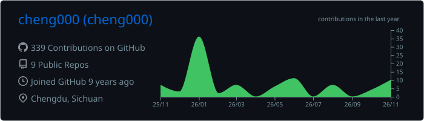
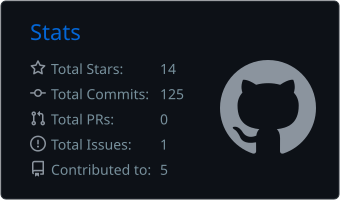
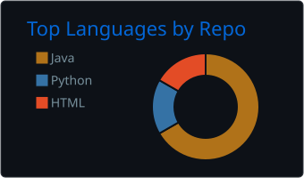
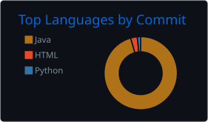

  

  

---

## 🧭 ⭐ 星标项目分类导航

> 共整理 **126 个项目** 到 **31 个分类列表**，点击下方标签直达对应列表页（移动端 / 模板类等 8 个空列表未展示）。

**🌱 语言与基础**

     

**🤖 AI · Agent**

  

**🧩 框架学习**

    

**🚀 我的项目**

  

**📦 库与插件**

 

**🛠️ 工具与收藏**

   

---

## 🛠️ 技术栈

---

## 📊 GitHub 统计

  <picture>
    <source media="(prefers-color-scheme: dark)" srcset="https://raw.githubusercontent.com/cheng000/cheng000/main/profile-summary-card-output/github_dark/0-profile-details.svg" />
    <source media="(prefers-color-scheme: light)" srcset="https://raw.githubusercontent.com/cheng000/cheng000/main/profile-summary-card-output/github_light/0-profile-details.svg" />
    
  </picture>
  <picture>
    <source media="(prefers-color-scheme: dark)" srcset="https://raw.githubusercontent.com/cheng000/cheng000/main/profile-summary-card-output/github_dark/3-stats.svg" />
    <source media="(prefers-color-scheme: light)" srcset="https://raw.githubusercontent.com/cheng000/cheng000/main/profile-summary-card-output/github_light/3-stats.svg" />
    
  </picture>
   
  <picture>
    <source media="(prefers-color-scheme: dark)" srcset="https://raw.githubusercontent.com/cheng000/cheng000/main/profile-summary-card-output/github_dark/1-repos-per-language.svg" />
    <source media="(prefers-color-scheme: light)" srcset="https://raw.githubusercontent.com/cheng000/cheng000/main/profile-summary-card-output/github_light/1-repos-per-language.svg" />
    
  </picture>
  <picture>
    <source media="(prefers-color-scheme: dark)" srcset="https://raw.githubusercontent.com/cheng000/cheng000/main/profile-summary-card-output/github_dark/2-most-commit-language.svg" />
    <source media="(prefers-color-scheme: light)" srcset="https://raw.githubusercontent.com/cheng000/cheng000/main/profile-summary-card-output/github_light/2-most-commit-language.svg" />
    
  </picture>

---

## 🐍 贡献贪吃蛇

  <picture>
    <source media="(prefers-color-scheme: dark)" srcset="https://raw.githubusercontent.com/cheng000/cheng000/output/github-contribution-grid-snake-dark.svg" />
    <source media="(prefers-color-scheme: light)" srcset="https://raw.githubusercontent.com/cheng000/cheng000/output/github-contribution-grid-snake-light.svg" />
    
  </picture>

---

## 🔗 快捷入口

  
  
  

  

